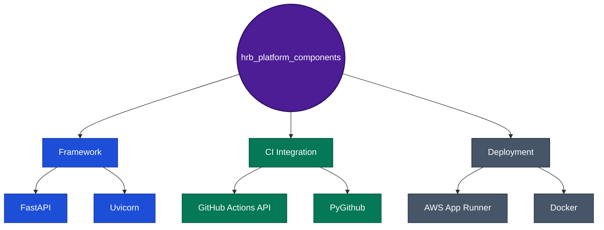

# hrb_platform_components

Platform/admin capabilities for the HRB chatbot system: CI/CD dashboard, Interview Q&A, MCP tool catalog. No core RAG business logic, no LLM involvement - genuinely the odd one out among the 7 repos in this split.

## For reviewers / new team members (5 minutes)

1. Run it locally (below) and hit `GET /ping`.
2. [Current state architecture](../docs/architecture/diagrams/hrb-platform-components-current-state-architecture.drawio) - the 3 modules that exist and why none of them touch an LLM.
3. [Target state (scaling)](../docs/architecture/diagrams/hrb-platform-components-target-state-scaling-architecture.drawio) - the honest counter-example in this platform's own diagram set: this one doesn't need a growth story, and the diagram says so directly instead of inventing one.
4. [Deployment architecture](../docs/architecture/diagrams/hrb-platform-components-deployment-architecture.drawio) - the actual AWS resources, smallest instance size of the 6 containerized services.

## Live demo

Not user-facing - this backs the Admin Dashboard's CI/CD, Interview Q&A, and
MCP tool-catalog tabs inside
**[hrb-chatbot-ui.rvsree.dev](https://hrb-chatbot-ui.rvsree.dev)**, visible
only to the `admin` identity (secret-code gated, restricted to the project
owner).

## Quick start

```bash
pip install -r requirements.txt
uvicorn src.platform.main:app --host 0.0.0.0 --port 8200 --reload
curl http://127.0.0.1:8200/ping
```

Tests: `pytest tests/ -v` from the repo root.

## Tech stack



| Layer | What's actually used |
|---|---|
| Framework | FastAPI + Uvicorn |
| CI integration | GitHub Actions REST API (via `PyGithub`), re-grounded 2026-10-24 for the 7-repo split as it actually stands (Phase 255) |
| Shared code | `hrb_common_libs[observability,db,ci,mcp,auth]`, pinned to `v0.4.0` |
| Deployment | AWS App Runner (Docker, 2-stage build), 256 CPU / 512 Memory - smallest of the 6 containerized services |

## Status, 2026-10-24: live in production

**Open decision, resolved 2026-10-21: standalone.** Deploys as its own App Runner service, not mounted inside `hrb_rag_retrieval_service`'s process - see `CLAUDE.md`'s "Deployment model - resolved" section.

Deployed to AWS App Runner (`https://pgmzxemv5z.us-east-1.awsapprunner.com`), real OAuth2 client-credentials auth to `hrb_lms_mcp` (Phase 4). Smoke-tested live via `GET /v1/admin/mcp-tools`, which read its own config/secrets and made a working outbound call. The CI/CD dashboard's own `Application` model was corrected 2026-10-24 (Phase 255) - the previous 4-member set predated this repo's own split and no longer matched reality.

See `ROADMAP.md` for phase history. 3 orphan admin routes (admin-docs-sync-to-S3, request-metrics, FAQ submissions) still have no confirmed home in this repo or `hrb_rag_retrieval_service` - flagged, not resolved.

## Documentation index

| Doc | What it covers |
|---|---|
| [`platform-and-admin/`](../docs/platform-and-admin/) | `cicd-pipeline-visibility/`, `interview-faqs/`, `admin-secret-code/` - the full HTML doc sets |
| [Build process](../docs/deployment-and-ops/build-and-deploy/06a-hrb-platform-components-build-process.html) | Docker build, step-by-step |
| [Deployment architecture (HTML)](../docs/deployment-and-ops/build-and-deploy/06b-hrb-platform-components-deployment-architecture.html) | Same content as the `.drawio` above, narrative form |
| [`microservices-interface-matrix.html`](../docs/architecture/microservices-interface-matrix.html) | §5 - the deployment-model decision for this specific repo |
| [`platform-overview.html`](../docs/architecture/platform-overview.html) | The cross-service hub - business capabilities, all 7 repos, one diagram |

Older paths under `docs/dev-reference/` (no `hrb_chatbot_v3/` prefix) referenced in earlier commits are stale - that folder was reorganized 2026-10-23, and the links above reflect where things actually live now.
